# Project 2.5 - Image Colourisation: State Space Restoration
Name: Amy Clinton

Student Number: 48448284

## Feasability Check-Off
### 1. User Need, Scope & Acceptance Criteria

Image colourisation has applications in restoration of historical photos. The intended user of such tools is someone who wants to convert grayscale to colour more easily and quicker than can be done manually by hand. This prototype would demonstrate that a state-space model, such as MambaIRv2, can be adapted for colourisation.

**Acceptance criteria**

Generally, my acceptance criteria is for the MambaIRv2 model to perform better than the basic CNN baseline performed.

| # | Criteria                 | Target |
|---|--------------------------|--------|
| A | Quantitative Metrics     | PSNR > 22; SSIM > 0.91; LPIPS < 0.20; Colorfulness > 20.5 |
| B | Qualitative              | Minimal failure cases, particularly focussed on desaturation and chromatic hallucinations |        
| C | Performance Restrictions | 8 GB VRAM budget; runtime < 5 hr  for fine tune, < 3 hr for frozen on local machine |


### 2. Model Choice & Course Concepts

**Chosen Difficulty**: Hard

I chose this project despite it being hard because image colourisation seems interesting, and the results seem a lot more engaging for me to interact with.

**Dataset**

I decided to use BSD500 (link ref dataset) as my dataset for training and testing. I chose this dataset as it has a wide variety of images, and because it was relatively small but larger than BSD50. This would make it so that runtime should not be too slow, while results are still good. 
This dataset has 500 images in total, with a split of 70% (350) training data, 15% (75) validation data and 15% (75) testing data.
All images in the dataset are resized to 256 x 256 pixels, and transformed into CIE LAB colour space for use with training and testing models.
LAB colour space consists of L (lightness), which serves as grayscale input, a (green-red) and b (blue-yellow) which serve as the predicted output.
CIE LAB colour space is standard for colourisation tasks because LAB is useful for detecting differences in colour seperately from how bright/dark the colour may be. 


**Model Architecture**

For the *baseline CNN* model, a basic autoencoder structure was used, the encoder extracts features while decoder reconstructs spatial resolution. This simple model can serve as a baseline of minimum competence.
- CNN 
- 1 -> 64 -> 128 -> 256 -> 128 -> 64 -> 2
- Trained with MSE, L1, L1_Sat, and LPIPS

*MambaIRv2 (Light)*: MambaIRv2 is a state-space model for image restoration, particularly for denoising and resizing purposes. The 'light' version is smaller than the base model with less embeded dimensions and was chosen so that training could perform quicker. The core building block of MambaIRv2 models is the Aggregated Selective State-space Block (ASSB). The structure shown in the diagram below

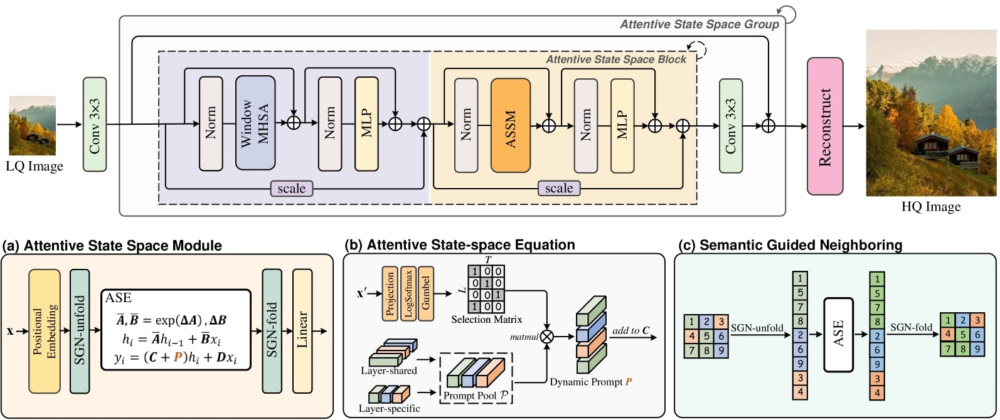

ASSB blocks contain:
- Window Multi-Head Self-Attention (Window-MHSA): uses non-overlapping windows to capture local spatial context
- Attentive State Space Module (ASSM): 
    - SGN-unfold: scores tokens by semantic similarity and reorders token sequence so related tokens are adjacent
    - Selective scan: selectively lets the model decide what to remember and what to forget
    - Addaptive State Expansion (ASE) : dynamically expands the state dimensions for tokens that need richer context, and shrink for simpler regions
    - SGN-fold: restore original spatial layout 


Instead of low quality image input and high quality image output, we want to have 1-channel L input and 2-channel ab output. So, we can addapt the model and keep the structure all the same, however change the input and output layer, as well  as upsampling disabled. Pretrained weights from [MambaIRv2 Light SR x2 ](https://github.com/csguoh/MambaIR/releases/tag/v1.0 
) are loaded with shape-filtered transfer, layeres whose shapes match are loaded, and mismatched layers are reinitialised.

There are two training strategies that we can use on this altered model. We can freeze the pretrained weights, and only train the conv_first and conv_last, or we can train through every layer. These strategies are refered to as "Frozen" and "Finetuned". 
I also seek to compare two loss functions, being L1 + desaturation penalty, and LPIPS (AlexNet) + L1. These are referred to as "l1_sat" and "lpips" respectively. 

### 3. Preliminary Feasability Evidence

**CNN Baseline (100 epochs, L1 loss)**

| Metric | Value |
|--------|------|
| PSNR | 22.66 |
| SSIM | 0.9112 |
| LPIPS | 0.2086 |
| Colorfulness | 20.58 / 40.58 |

This CNN produced structurally correct but desaturated output, confirming the need for a saturation-aware loss ans more powerful feature extractors.

**Frozen l1_sat (as of epoch 5)**

| Metric | Value |
|--------|-------|
| PSNR | 22.14 |
| SSIM | 0.9001|
| Epoch time | 186 s |

Expected run time = 2.6 hrs

**Finetuned l1_sat (as of epoch 5)**

| Metric | Value |
|--------|-------|
| PSNR | 23.27 |
| SSIM | 0.9312|
| Epoch time | 551 s |

Expected run time = 7.7 hrs

Wonderfully, the PSNR and SSIM of this model is already better than the CNN!

**Feasibility**

The expected run time of the finetune model seems to exceed the acceptance criteria, and running these models is estimated to take 20 hours in total on my local machine. This can be easily done over the course of two overnight training runs that can occur while my computer is not in use. 

### 4. Risks, Budget & Fallback


| Risk                              | Mitigation / Fallback             |
|-----------------------------------|-----------------------------------|
| Finetune model runs out of memory | Per-layer gradient checkpointing  |
| Pretrained weights incompatible   | Shape-filtered loading            |
| Training time exceeds expectation | 50 epochs                         |
| MambaIRv2 underperforms           | Use larger dataset, add more epochs, run on Virtual GPU Lab |


### Checked Off

Checked off on 27th of October.
Suggestions:
- Substantially more VRAM would be ideal so that more training can be done 
- A much larger dataset than 500 images would be needed for good results


## Dependencies


This is designed to run in linux. If you have a windows machine, you can the windows subsystem for linux (wsl) and install ubuntu

``` 
# clone this repository
git clone https://github.com/amyntyalien/PatternAnalysis-2026.git
cd PatternAnalysis-2026

# create a virtual environment
conda create -n mamba-colour python=3.10 pip -y
conda activate mamba-colour

# install dependencies
pip install --no-cache-dir torch torchvision transformers==4.44.2 \
    einops ninja packaging matplotlib opencv numpy \
    scikit-image lpips timm==0.9.16 basicsr scikit-learn path

# install mamba
git clone --depth 1 --branch v2.2.6.post3 https://github.com/state-spaces/mamba.git mamba-226
cd ~/mamba-226

sed -i 's/-std=c++17/-std=c++20/g' setup.py

MAX_JOBS=1 MAMBA_FORCE_BUILD=TRUE TORCH_CUDA_ARCH_LIST=12.0 \
python -m pip install --no-build-isolation --no-cache-dir --no-deps .

# install the pretrained weights into the correct path
mkdir -p recognition/MambaIRv2_s48448284/checkpoints
wget https://github.com/csguoh/MambaIR/releases/download/v1.0/mambairv2_lightSR_x2.pth -O recognition/MambaIRv2_s48448284/checkpoints/mambairv2_lightSR_x2.pth
```

**Key package versions:**
| Package | Version |
|---------|---------|
| torch | 2.14.1+cu130 |
| torchvision | 0.29.1 |
| mamba_ssm | 2.2.6.post3 |
| causal_conv1d | 1.7.0 |
| lpips | 0.1.4 |
| timm | 1.0.30 |
| einops | 0.8.2 |
| scikit-image | 0.26.0 |

**Note on mamba_ssm installation:** The above pip install builds mamba_ssm from source 
targeting CUDA 12.0. On systems with CUDA 13.0 (such as Rangpur HPC with PyTorch 
2.14.1+cu130), the compiled CUDA extension (`selective_scan_cuda`) will not load. In this 
case, mamba_ssm falls back to a pure-Python implementation (`selective_scan_ref`) 
automatically via a patch to `selective_scan_interface.py`. Training is functionally 
correct but approximately 10× slower per epoch.

## Loss Function

As mentioned in Feasibility Checkoff - Model Choices, I wanted to compare how different loss functions can affect the models output, and determine which loss function is best for this task.

The Analysis of Different Losses for Deep Learning Image Colorization paper (https://arxiv.org/pdf/2204.02980) compares L1, L2, LPIPS, WGAN + L2, and WGAN + LPIPS loss functions and concluded that "LPIPS produces slightly better results". 
It is not expected that the loss function will have a major impact, however it is interesting to see if one performs better than the other


**L1 + Saturation Penalty (l1_sat):**

$$\mathcal{L}_{l1\_sat} = \|ab_{pred} - ab_{true}\|_1 + \lambda \cdot \max(0,\, S_{target} - \|ab_{pred}\|_2)$$

 $\lambda = 0.1$ was used as the saturation weight and $S_{target}$ penalises predictions that are too desaturated. 
This encourages the model to commit to more vivid colours rather than regressing to grey.

**LPIPS + L1 (lpips):**

$$\mathcal{L}_{lpips} = \text{LPIPS}_{Alex}(RGB_{pred}, RGB_{true}) + 0.1 \cdot \|ab_{pred} - ab_{true}\|_1$$

LPIPS uses an AlexNet feature extractor to measure perceptual similarity rather than 
pixel-wise distance. Converting ab predictions to RGB for LPIPS computation adds overhead 
but produces perceptually richer outputs.

## Baseline Model
### Quantitatively

| Metric       | MSE    | L1     | L1_sat | LPIPS   |
|--------------|--------|--------|--------|---------|
|PSNR          | 22.6826| **22.6877**| 22.6210| 21.8546 |
|SSIM          | **0.9131** | 0.9112 | 0.9096 | 0.8065  |
|LPIPS         | 0.2035 | 0.2086 | 0.2065 | **0.2113**  |
|Colourfulness | 20.46  | 20.58  | 22.25  | **22.42**   |

The results of CNN show that L1 and MSE achieve the best PSNR/SSIM (pixel accuracy) whereas LPIPS loss achieves the best perceptual colorfulness. This confirms the known trade-off that pixel-regression losses result in structurally accurate but desaturated outputs, while perceptual losses result in more vivid but sometimes less pixel-accurate outputs . 
L1+Sat is a compromise between PSNR and colorfulness (22.25) at a small cost in PSNR.


### Qualitatively
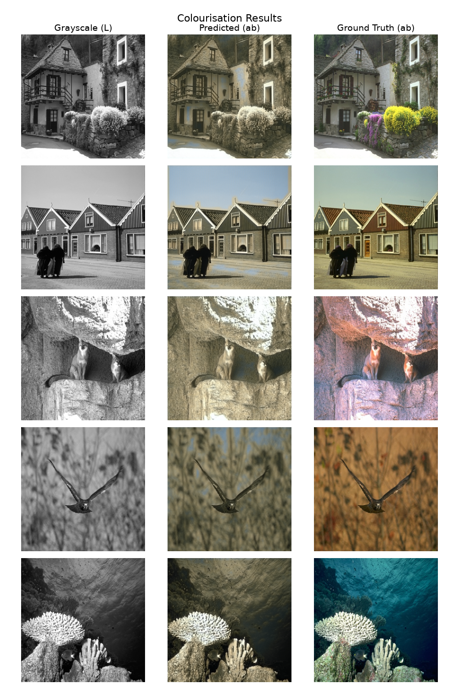

Qualitatively, all the CNN variants produce muted, brownish colors in ambiguous regions (food, indoor scenes), confirming that a simple encoder-decoder lacks the global context required for plausible colourisation. This results in the application of MambaIRv2’s global receptive field. Though blue sky output were achieved from time-to-time.

## MambaIRv2 Results
### Quantitatively

I've placed the best result from any CNN in each metric

| Metric       | Best CNN |Frozen & l1_sat | Frozen & lpips   | Finetuned & l1_sat | Finetuned & lpips |
|--------------|------|-----------------|------------------|--------------------|-----------------|
|PSNR          | 22.6877 |22.5548| 21.9421 | **22.9920** | 22.9800 |
|SSIM          | 0.9131 |0.9147 | 0.8992  | **0.9275** | 0.9178 |
|LPIPS         | 0.2035 |0.1952 | 0.1971  | 0.1874 | **0.1787** |
|Colourfulness | 22.42 |17.21  | 23.20   | 22.56  | **24.27** |
|Average time  | < 36 |**185.0**  | 186.2   | 577.5  | 551.2 |
| Total time | < 1 hr |2.6 hrs | 2.6 hrs |8.0 hrs | 7.7 hrs |

The frozen MambaIRv2 models were not better than the CNN baseline in terms of PSNR, getting 22.55 compared to the CNN's 22.69, despite being a substantially more complex model. That is to be expected: 
freezing pretrained SR weights means only the input/output convolutions are learnt, which limits a model's ability to adapt to the color prediction task severely. Yet frozen MambaIRv2 already produces better LPIPS (0.1952 vs 0.2035) hinting that the pretrained features provide a more perceptually coherent color even without full fine-tuning.

Finetuned models outperform the CNN for all metrics except colorfulness for l1_sat, confirming that full fine-tuning is needed to adapt the SR-pretrained weights to color prediction.

Note: the training loss curve always shows 0 due to a bug where it was never 
accumulated in the training loop (the loss was computed and backpropagated correctly — 
only the variable was affected). This was discovered after all training was 
complete and does not affect model weights or validation metrics.

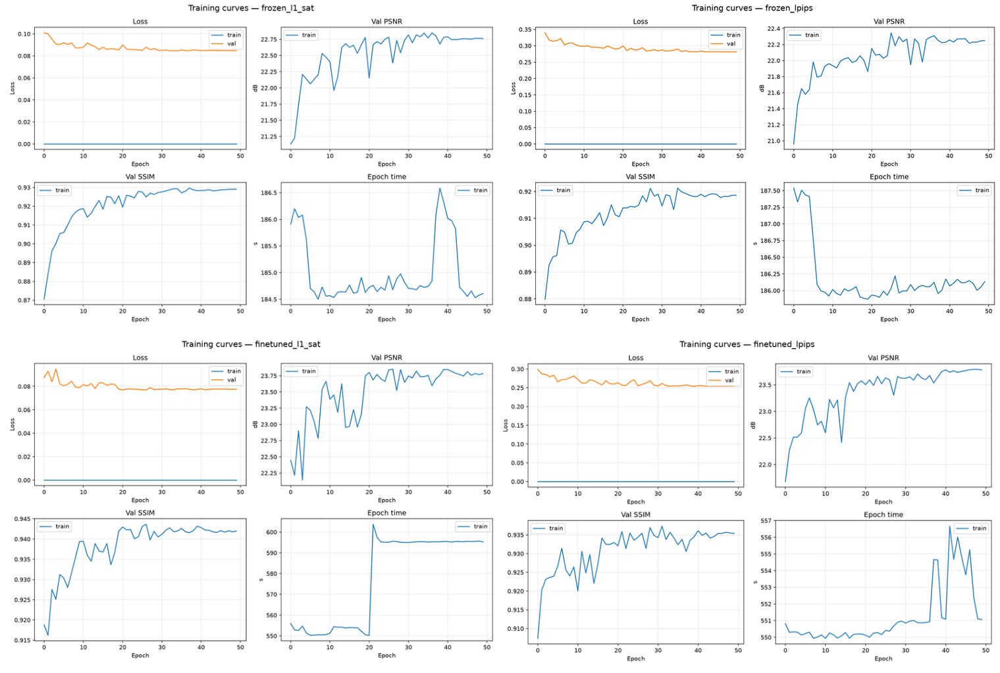

The validation loss curves show smooth convergence for all four models with no signs of 
overfitting within 50 epochs, suggesting more epochs could further improve results. 
Epoch times for finetuned l1_sat are slightly elevated due to an application running 
in the background during one training session.

### Qualitatively


| Finetuned l1_sat | Finetuned lpips | Notes |
|------------------|-----------------|----|
| 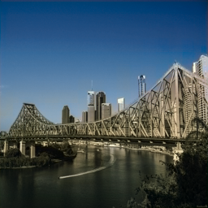  | 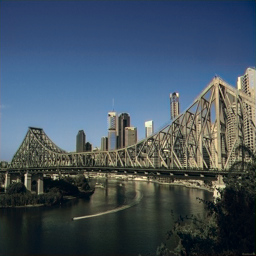   |Both models i dentify a strong blue sky, and a teal-grey river. These are both strong. |
| 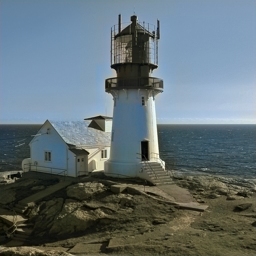   |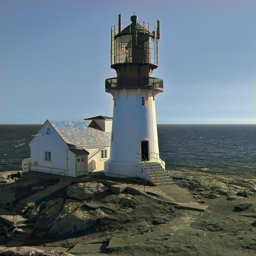 | The sky and water are both redered blue. The l1_sat model seems to be more saturated here. Both models produce a desaturated foreground. |
| 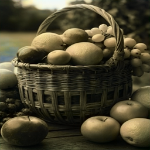  | 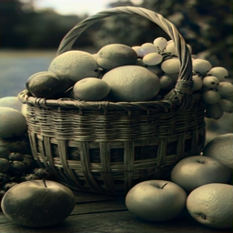   | Both models have failed severly here, with inconsistent colour splotches, chromatic hallucination, and desaturated output. |
| 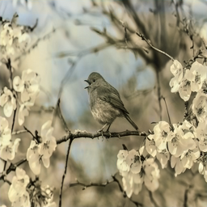  | 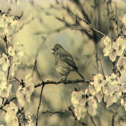   | Both the flowers and the bird are incorrectly coloured, due to the models not knowing what colour they should be. L1_sat has attempted a blue sky, however does not correctly identify all areas of the sky |


## Improving results

Initial results were disappointing in terms of qualitative plausibility. Per the fallback plan from the feasibility review, training was repeated with a larger and more diverse dataset. 

In addition to the BSD500 dataset, 2000 COCO images were added, giving 2500 total training images — 5× larger. COCO was chosen for its diversity: urban, food, people, animals, and nature scenes, which should improve generalisation beyond BSD500. Due to compational limitations (estimated training time of 40 hours) only the finetuned l1_sat variant was retrained.

I also wanted to add more epochs and train on the Virtual GPU lab or on Rangpur, however estimated training times after completing 1 epoch showed that these would take far too long.

## Results after getting larger dataset

### Quantitatively 

| Metric       | Previous Finetuned l1_sat| More data finetuned l1_sat | 
|--------------|--------|-------------------|
|PSNR          | 22.9920 | **23.5957**| 
|SSIM          | **0.9275** | 0.9202 |
|LPIPS         | 0.1874 | **0.1783** |
|Colourfulness | **22.56** / 40.58 | 20.45 / 41.08 |
|Average Time  | 577.5 | 3395   |
|Total Time    | 8.0 hrs | 47.1 hrs |

Unfortunately, improvements are marginal. While PSNR and LPIPS have improved, SSIM has not, and colorfulness has regressed.

### Qualitatively
| Previous Finetuned l1_sat | More data finetuned l1_sat | Notes|
|--------------------------|-------------------------| ----|
|   | 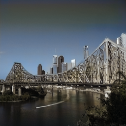  | The new model produces slightly warmer tones in the background, however the sky and water is much less saturated.
|    |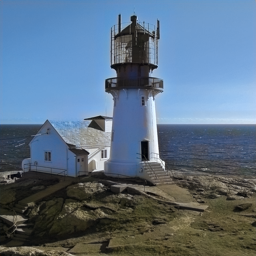 | This image has become a lot better, the sky is more blue, the water is more realistic, and the foreground has also improved slighly
|  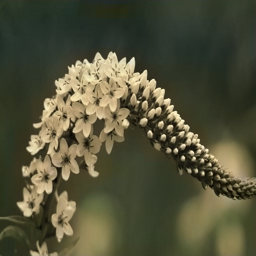  | 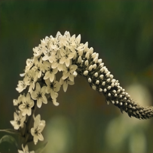   | These flowers seem quite desaturated despite the increase in training data. Surrounding environment is more vibrantly green. COCO does not have many floral images.
|    | 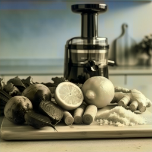   | Output is mroe desaturated. The infoor environment is rendered with very warm tones, COCO training data contains many indoor scenes with warm lighting.


## Reflection


| # | Criteria                 | Target | Achieved |
|---|--------------------------|--------| ---------|
| A | Quantitative Metrics     | PSNR > 22; SSIM > 0.91; LPIPS < 0.20; Colorfulness > 20.5 | For final model (2500 images): PSNR:✅ SSIM:✅ LPIPS:✅ Colorfulness:❔ |
| B | Qualitative              | Minimal failure cases, particularly focussed on desaturation and chromatic hallucinations |❔ -  Outdoor scenes perform reasonably, however many objects are coloured incorrectly due to ambiguity and lack of training data |
| C | Performance Restrictions | 8 GB VRAM budget; runtime < 5 hr  for fine tune, < 3 hr for frozen on local machine | 500 image models: ✅ ❌ ✅|


Personally, I wish I completed the check off earlier, as my tutor suggested things that I could've easily known earlier, instead of "finding out the hard way" on my own when there was not as much time left to truly act on those.

## Engineering Recommendation

From this analysis, colourisation with MambaIRv2 is not recommended. It has potential to perform well for scenes with strong, well defined features (clear sky, water, vegetation). Various objects that are not well defined by the model can not be reliably colored by the model. The model struggles with food, flowers, biological subjects and so on, where color is semantically determined and cannot be easily predicted from luminance alone. MambaIRv2's linear-time global receptive field allows for structurally coherent colors. This led to good respect of sky/water boundaries, and consistent coloring of large uniform regions. But global context does not always do enough to sort out color ambiguities and fine-textured subjects can still end up with unnatural splotches.

The model is essentially minimizing error over a distribution of plausible colors, so it predicts a desaturated mean rather than making a commitment to specific hues. This kind of failure can be solved by a generative approach sampling from a color distribution. 
 

| Model	            | PSNR |	    SSIM    | LPIPS |	    Colourfulness | Epoch time|
|-------------------|------|----------------|------|------------------------|------|
|Frozen L1+Sat      |22.55      |0.9147	        |0.1952|	17.21|	185s|
Frozen LPIPS	    |21.94	    |0.8992	        |0.1971	    |23.20	|186s	
Finetuned L1+Sat (500)	|22.99	|**0.9275**	    |0.1874	    |22.56	|578s	|
Finetuned LPIPS (500)	|22.98	|0.9178	        |0.1787	    |**24.27**	|551s	|
Finetuned L1+Sat (2500)	|**23.60**|0.9202	    |**0.1783**	|20.45	|3395s	|

Trade-off recommendation: Finetuned LPIPS (500 images) provides the best perceptual quality per compute hour — highest Colorfulness and lowest LPIPS at 7.7 hours of training. The 2500-image model further improves PSNR and LPIPS but with 47 hours training time and a decrease in Colorfulness, it seems there are diminishing returns from data scaling alone without changes to the architecture.


## Artificial Intelligence Usage Disclosure
|AI Tool | Usage | How it was verified |
|--------|--------|--------------------|
| Claude | Generated checklist to provide step by step plan | I also read the task sheet in full |
| GPT Luna | helped with getting the project working with correct versions, using WSL for Ubuntu and other environment set up | I read installation errors and verified if AI suggestions were targetting those errors |
| Claude | assist in writing code and scaffolding functions | Every line of code was handwritten by myself, even when copying from Claude, I asked questions, simplified, or rewrote the code myself. I find that typing it out myself rather than blindly copy pasting forces me to slow down and think about it more |
| ChatGPT | Generated the equations for loss functions that are present in this markdown | 
